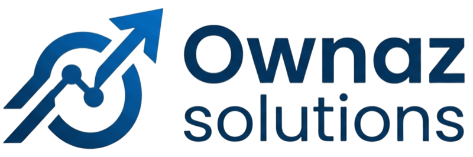

<div align="center">

<a href="https://ownaz.tech"></a>

### Have an idea? We build it.
### Have a problem? We find the solution.

**Product Development · R&D as a Service · Digital Solutions**

[](https://ownaz.tech)
[](mailto:ownazsolutions@gmail.com)
[](https://wa.me/233505712984)

</div>

---

We're a product development, R&D and digital solutions group based in **Accra, Ghana** 🇬🇭.
We take ideas from first sketch to shipped product, and problems from first question to working
fix, across web, mobile, cloud and hardware.

## What we do

<table>
<tr>
<td width="33%" valign="top">

### 🧩 Product Development
*Have an idea? We build it.*

We take your idea from concept to a product people use, then keep improving it after launch.

- Product discovery & UX design
- MVPs and full product builds
- Web, mobile & desktop apps
- Connected devices & IoT
- Launch, app stores & iteration

</td>
<td width="33%" valign="top">

### 🧪 R&D as a Service
*Not sure it can be done? We find out.*

Your R&D team on demand. We test approaches and build working prototypes, so you decide with evidence.

- Feasibility & technical research
- Rapid prototypes & proofs of concept
- AI, LLM & data experiments
- Hardware, sensors & IoT trials
- Clear findings & a build plan

</td>
<td width="33%" valign="top">

### 🔗 Digital Solutions
*Have a problem? We find the solution.*

For disconnected systems, manual work and tools that don't fit: we design the fix, build it and keep it running.

- System integration & APIs
- AI automation & workflows
- Custom business software
- Cloud hosting & DevOps
- Support & maintenance

</td>
</tr>
</table>

## How we work

```
  01 Discover  ──►  02 Prototype  ──►  03 Build  ──►  04 Run & Support
  the idea or       prove it before    weekly demos   we host, monitor
  the problem       you commit         to production  and keep improving
```

## What we ship with

**Build**
<br/>


**Run**
<br/>


## Let's talk

<div align="center">

**Bring us an idea or a problem.** We reply within 24 hours.

[ownaz.tech](https://ownaz.tech) · [ownazsolutions@gmail.com](mailto:ownazsolutions@gmail.com) · [+233 50 571 2984](tel:+233505712984)

<sub>Built in Accra, Ghana.</sub>

</div>
